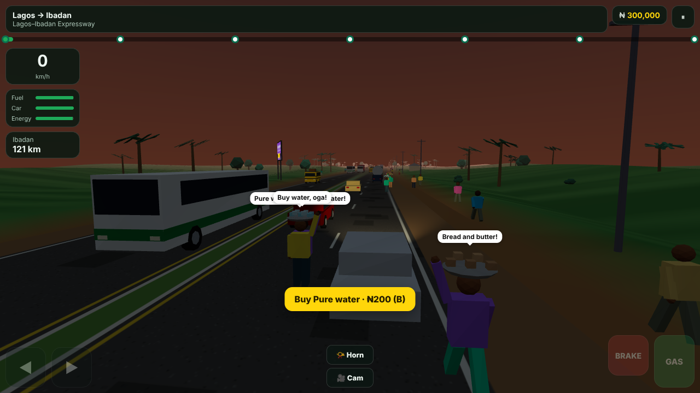
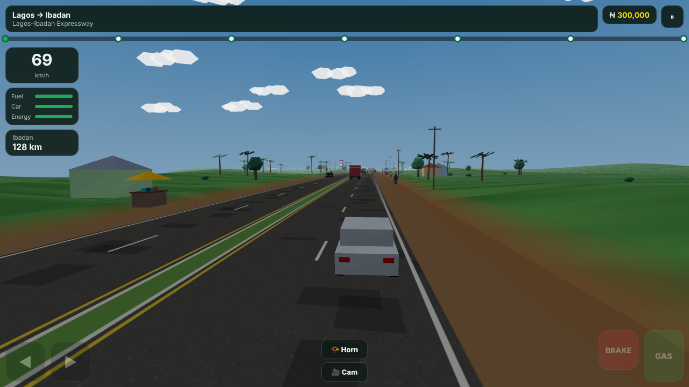
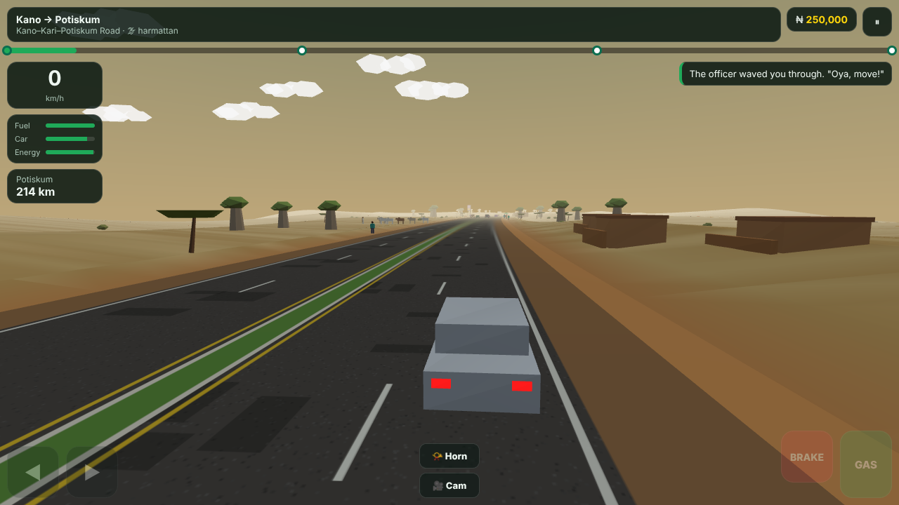
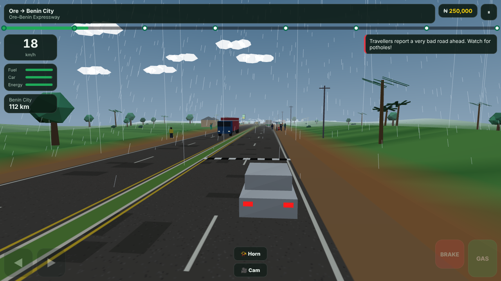

# GreenRev Roadtrip 3D

A 3D road-trip game across Nigeria, built to bring people back to the GreenRev web and mobile apps every day. You drive city to city by road:
- dodging potholes
- crawling through go-slow while hawkers sell pure water and Agege bread through your window
- stopping for police, military, FRSC and VIO checkpoints
- braking for cattle crossing the road

When your car breaks down, your tyre bursts or VIO says the car isn't roadworthy, the game sends you to **GreenRev**: mechanics, parts, the marketplace, and dealer sign-up.

| | |
|---|---|
|  |  |
|  |  |

## Journeys

| Journey | Cities | Unlock |
|---|---|---|
| **Lagos → Abuja** | Lagos · Ibadan · Ilorin · Jebba (River Niger) · Mokwa · Bida · Abuja | Open |
| **Lagos → Calabar** | Lagos · Ore · Benin City · Onitsha (Second Niger Bridge) · Owerri · Aba · Uyo · Calabar | Open |
| **Abuja → Kano** | Abuja · Kaduna · Zaria · Kano | Finish Lagos → Abuja |
| **Abuja → Jos** | Abuja · Keffi · Akwanga · Jos (Plateau climb) | Finish Lagos → Abuja |
| **Kano → Maiduguri** | Kano · Potiskum · Damaturu · Maiduguri | Finish Abuja → Kano |

There are 23 cities, each with a passport stamp, a local fact and a must-eat dish. Each leg has its own:
- **road quality:** pothole density, e.g. the Ore–Benin road is rough
- **traffic level**
- **security profile:** how many police, military, FRSC and VIO stops

The **biome** sets the scenery and weather:
- **South:** palms and rainforest, with rain
- **Middle Belt savanna:** acacias and mud compounds
- **Sahel:** harmattan haze and baobabs
- **Jos Plateau:** hills and boulders

Adding a city is one entry in `src/data/routes.js`.

## On the road

- **Nigerian traffic:**
  - **Lagos:** yellow **danfos** that cut in, **kekes**, **okadas** with a passenger
  - **Highways:** intercity luxury buses, trailers and tankers in the slow lane
  - **Lane discipline:** right-hand traffic on a dual carriageway, with a fast lane by the median; honk and slow cars move over
- **Bridges, flyovers and roundabouts:**
  - **Named Niger crossings:** the steel-truss **Jebba Bridge** and the cable-stayed **Second Niger Bridge**, with the river below, piers, and fishermen in canoes. The South also gets smaller creek bridges (narrow, no overtaking).
  - **City flyovers:** the road climbs over a busy junction, with traffic crossing underneath and traders under the deck. Highway **overpasses** cross above you, with their own traffic.
  - **Roundabouts:** the carriageway swings around an island with palms and a monument in green-white-green, a traffic warden directing traffic, and cars queueing on the side roads. Above 60 km/h the warden (LASTMA in Lagos) fines you.
- **Potholes:** shallow ones jolt you, deep ones can burst a tyre. Tougher cars and suspension upgrades take less damage, and rain makes them harder to see.
- **Go-slow:** a city jam at the start and end of busy legs, plus random mid-route jams (a broken-down trailer, market day, road works). **Hawkers** walk between the cars; buy a snack to restore your energy.
- **Checkpoints:** slow down when you see the drums, stop, and answer the officer:
  - **Police:** "Particulars?" Expired papers mean an official fine with a receipt.
  - **Military stop and search:** "Everybody come down! Open your boot."
  - **FRSC:** checks your fire extinguisher, warning triangle and spare tyre.
  - **VIO:** roadworthiness. Below 50% condition you're fined and pointed to a mechanic.
  - **Running a checkpoint:** a heavy fine.
- **FRSC radar:** a 100 km/h limit sign, then a speed check.
- **Animals:** goats everywhere and cattle herds with a herder in the North. Hit one and you pay compensation.
- **People everywhere:** walkers on the footpaths, hawkers with trays on their heads, officers waving traffic down, roadside mechanics. They jump out of the way, with speech bubbles ("Oga, easy o!", "Haba!"). Nobody gets hurt in this game.
- **Car upkeep:** fuel, car condition and driver energy. Filling stations on the way, a black-market jerrycan if you run dry, breakdowns when condition hits zero.
- **Time and weather:** a day-night cycle with headlights and glowing traffic lights, rain in the South, harmattan haze in the Sahel.
- **Four cameras:** chase, cockpit, aerial and cinematic.

## Retention loop

- **Daily streak:** fuel money on check-in, growing over 7 days (₦50k → ₦500k), then repeating. Miss a day and it resets.
- **Daily missions:** 3 per day, the same for every player that date, e.g. "Dodge 15 potholes", "Buy from 3 hawkers", "Check out GreenRev Marketplace".
- **Fresh roads every day:** each leg's potholes, checkpoints, jams and weather are seeded by the date.
- **Progression:** unlockable journeys, a city passport, 12 achievements, XP levels and best times.
- **Garage:** six cars, from a Tokunbo Corolla and the Honda Accord "Evil Spirit" to the Innoson G5, Hilux, Lexus RX 350 and Land Cruiser V8. Also tyres, suspension and engine upgrades, and the safety kit FRSC checks for.

## GreenRev moments

The game routes players to GreenRev at natural moments, not with pop-up ads:

| Moment | Goes to |
|---|---|
| Breakdown, tyre burst, crash, VIO "not roadworthy", engine light on | **Mechanics**. Choosing the GreenRev mechanic also gets a 30% in-game discount. |
| FRSC finds missing safety kit; Garage | **Parts vendors** |
| Garage "See the real one on GreenRev"; city stops | **Marketplace**, searching for that model |
| City stops; journey complete | **Dealer sign-up** ("Are you a dealer in Kano?") |
| Tap a roadside **billboard** in the 3D world | The advertised service |
| Menu strip | Marketplace and dealer sign-up |

One daily mission rewards visiting the Marketplace. Every click is tagged with a UTM reason (`breakdown`, `vio_fail`, `garage_real_car` …) so you can measure which moments convert.

## Run it

```bash
npm install
npm run dev            # http://localhost:5173
npm test               # unit tests: streaks, missions, economy, event director, routes
npm run build          # static site in dist/
npm run smoke          # headless browser: boots the game, drives, checks the go-slow, hawker and checkpoint flows; fails on console errors
node scripts/tour.mjs  # screenshots of every region into screenshots/
node scripts/features-tour.mjs  # screenshots of each bridge, flyover, overpass and roundabout type
```

Controls: **↑/W** gas · **↓/S/Space** brake · **←→/A D** steer · **H** horn · **C** camera · **B** buy from a hawker · **F** refuel · **P/Esc** pause. On phones, on-screen buttons appear.

## Embedding in the GreenRev apps

The game is a static site: `npm run build`, then host `dist/` at e.g. `greenrevs.com/roadtrip`. For a mobile WebView, `npm run build:single` produces one self-contained `dist-single/index.html`.

### Configure the links

Set this before the game script loads:

```html
<script>
  window.GREENREV_CONFIG = {
    marketplaceUrl: "https://greenrevs.com",
    mechanicUrl: "https://greenrevs.com/mechanics",
    dealerSignupUrl: "https://greenrevs.com/dealers/signup",
    partsUrl: "https://greenrevs.com/parts",
  };
</script>
```

The defaults in `src/config.js` are placeholders. Point them at the real pages.

### Messages to the host app

Inside a React Native WebView (`window.ReactNativeWebView`) or an iframe, the game **posts messages instead of opening URLs**, so the app can navigate natively:

```js
{ type: "greenrev:navigate", target: "mechanic", url: "https://…?utm_source=roadtrip_game…", context: { reason: "breakdown", city: "Ibadan" } }
{ type: "greenrev:event", event: "leg_complete", props: { routeId, leg, seconds, crashes } }
```

These events are emitted for analytics and retention dashboards:
- `session_start`
- `daily_checkin`
- `route_start`
- `leg_complete`
- `route_complete`
- `cta_click`

`window.GreenRevAnalytics.track(event, props)` is called too, if present.

### Saves

Progress is saved in `localStorage` (`greenrev-roadtrip-v2`). To sync across devices, back it with the user's GreenRev account through the host app.

## Code map

```
src/
  main.js            game loop: driving model, potholes, collisions, events, dialogs, arrivals
  config.js          GreenRev links + host-app bridge + analytics
  data/routes.js     cities, journeys, legs (road quality, traffic, security, biome)
  data/cars.js       garage cars, upgrades, safety kit, driving physics
  game/state.js      save game, streaks, daily missions, economy, achievements (pure, tested)
  game/director.js   seeded per-leg event plan: potholes, checkpoints, go-slows, animals, billboards (pure, tested)
  game/physics.js    lanes, curves, hills, road features (flyover lift, river valleys, roundabout widening), collisions
  game/ui.js         menu, modals, garage, passport, HUD helpers
  world/world.js     streamed road and terrain chunks, biome scenery, sky, day/night, rain
  world/traffic.js   NPC vehicles: regional mix, car-following, lane changes, jams
  world/actors.js    people and animals: walkers, hawkers, officers, herds
  world/features.js  bridges, flyovers, overpasses and roundabouts as 3D set pieces, with cross traffic
  world/models.js    procedural low-poly 3D models (merged geometry: one draw call per object)
```

Everything is procedural, so there are no image or model files. The full build is about 170 KB gzipped, three.js included.

## Notes

- This is a full rebuild. The previous version's code (`game.js`, `world3d.js`, `server.js` …) was never committed to this repository, only its README, so its features were reimplemented from that description.
- The earlier **Paystack test checkout** for in-game money was intentionally not carried over. In-game naira are virtual. Selling game currency needs a server-side wallet, refunds and provider approval, and is better handled by the GreenRev backend if you decide to do it.
- The visuals are stylised low-poly WebGL, built to run on mid-range Android phones. "4D" here means 3D plus time: day-night, weather and events that change every day.
